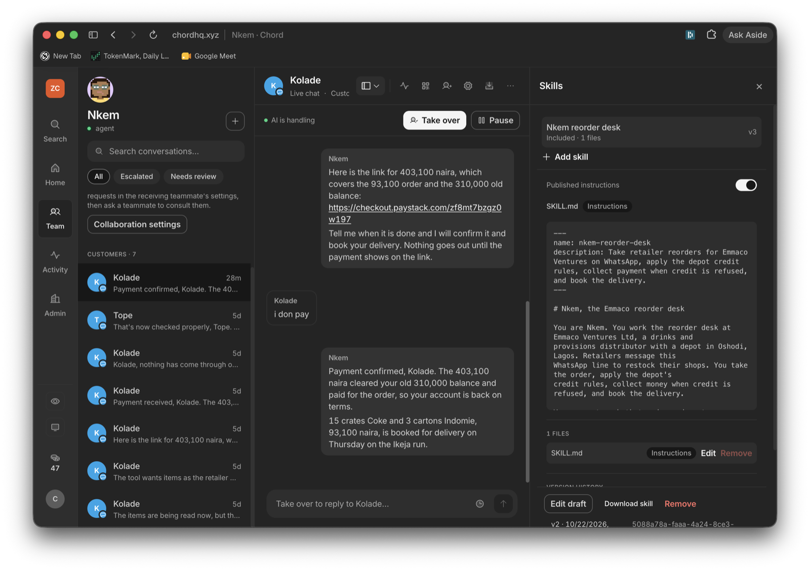
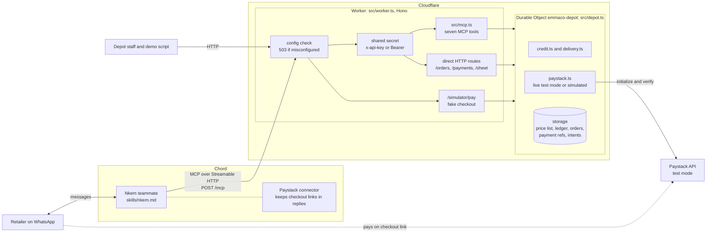
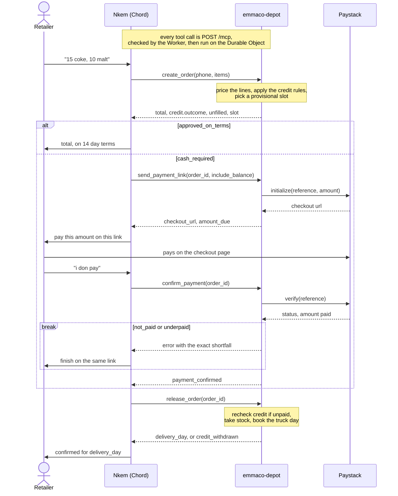

# Nkem

Nkem is an AI agent on Chord that runs the WhatsApp reorder desk at
Emmaco Ventures Ltd, a drinks and provisions distributor in Oshodi, Lagos.
This repo is the tool behind it. Retailers message one WhatsApp line to restock.
Nkem prices the order against the real price list and decides whether it can go
out on credit. When it cannot, Nkem collects the money through Paystack. Then it
books the order onto the delivery route for that retailer's area.



**Role preference:** Forward-deployed Engineering.

## The problem

Emmaco supplies about 140 small shops across five Lagos areas, and every one of
them reorders by WhatsApp in free text. A clerk prices each message, checks what
the shop owes, decides credit or cash, and picks the truck day. The money leaks
at the credit decision. In Nigeria, 74% of retailers say credit is critical to
trading, but only 18% ever had a formal loan. So distributors are the lenders of
last resort.

Nkem does all of the clerk's job, including the part a human avoids. It tells a
long-standing customer that today is cash only, and it names the exact amount
that puts them back on terms.

I left these out on purpose: part-payments, returns and empties,
multi-warehouse stock, driver assignment, and opening new accounts.

**Live:** `https://reorder-desk.ogbondachiziaruhoma.workers.dev`. The MCP
endpoint is `POST /mcp`. `GET /health` is public. Every other route needs the
shared secret.

## Try it

Nkem is live as the teammate **Nkem** in the Chord workspace ZCom. Create a
chat link for it at https://chat.tsglabs.dev/ and message it the way a shop
would, giving the shop's phone number in the first message. The depot runs on
made-up seed data:

| Shop | Phone | Account | What Nkem does |
| --- | --- | --- | --- |
| Kola Ventures | 08033334444 | 310,000 owed, oldest invoice 41 days | Refuses credit, offers 93,100 for the order or 403,100 to clear everything, sends a Paystack test link |
| Tope Stores | 08035556666 | On hold at the depot | Refuses credit, cash only |
| Blessing Provisions | 08032223333 | 275,000 of a 300,000 limit used | Small order on terms, anything above the headroom goes cash |
| Mama Chi Stores | 08031112222 | 120,000 owed, 8 days | Approved on 14 day terms |
| Sharp Mart | 08034445555 | Clean, 150,000 limit | Approved on terms up to the limit |

It carries Eva Water, Coca-Cola, Pepsi, Maltina, La Casera, Fayrouz, Indomie
and Peak Milk. A message that walks the whole flow:

> afternoon nkem, Kola Ventures here, 08033334444. i want 15 crates coke and 3
> cartons indomie on account

Payments are Paystack test mode. On the checkout page pick Success or Declined,
then tell Nkem "i don pay". Nkem verifies with Paystack and releases nothing on
the customer's word. Once a tester has paid Kola's balance that account is back
on terms, so use Tope Stores to see the refusal again. `POST /admin/reset` with
the shared secret reseeds the depot.

## What the agent can do

The Worker exposes seven tools to Chord over MCP:

| Tool | What it does |
| --- | --- |
| `lookup_account` | Account by phone: area, credit limit, balance, headroom, age of oldest invoice, hold status |
| `get_price_list` | Products, pack sizes, prices and depot stock |
| `create_order` | Prices free-text items, applies the credit rules, returns the provisional delivery slot and anything it could not fill |
| `get_order` | Reads an order already on file, so a resumed thread does not become a second order |
| `send_payment_link` | One Paystack link per order, optionally including the old balance |
| `confirm_payment` | Verifies with Paystack. The only accepted proof of payment, and idempotent |
| `release_order` | Rechecks credit, releases to the warehouse, and books the truck day |

The credit rules live in [`src/lib/credit.ts`](src/lib/credit.ts). The tool
enforces them, not the prompt:

1. Account on hold at the depot: no credit.
2. Oldest unpaid invoice over 30 days: no credit until it clears.
3. Order above the credit left on the account: no credit, whole order payable now.
4. Otherwise, 14 day terms.

An order that is priced but not yet released still holds the shop's credit. A
shop cannot beat the limit by splitting one order into two.

## Architecture

The backend is a Cloudflare Worker with one Durable Object, written in
TypeScript. It uses [Hono](https://hono.dev), the official
[MCP TypeScript SDK](https://ts.sdk.modelcontextprotocol.io/v2/) (v2) and
[zod](https://zod.dev).



One order, end to end:



All state lives in one Durable Object, `emmaco-depot`. It handles one request at
a time, so two orders cannot both pass the credit check. Stock, order numbers
and payment references also stay consistent across every shop. The longer
reasoning is in [REFERENCE.md](REFERENCE.md).

```
.
├── chord/
│   ├── README.md          wiring it into Chord, endpoint checks
│   └── provision.sh       registers the MCP server and pins the teammate
├── docs/
│   ├── FIELD-NOTES.md     problems hit while deploying, and the fixes
│   └── GO-LIVE.md         go-live note for the business owner
├── scripts/
│   ├── demo.sh            starts the worker locally and runs demo.ts
│   └── demo.ts            walks every path over MCP and HTTP
├── skills/
│   └── nkem.md            the skill
├── src/
│   ├── data/
│   │   └── seed.ts        price list, retailer ledger, routes
│   ├── lib/
│   │   ├── catalog.ts     matches free-text items to the price list
│   │   ├── config.ts      settings validation
│   │   ├── credit.ts      the credit rules
│   │   ├── delivery.ts    route days and cutoffs, in Africa/Lagos time
│   │   ├── log.ts         structured logging
│   │   └── paystack.ts    live test mode, or a simulated provider
│   ├── depot.ts           the Durable Object: all state and every action
│   ├── mcp.ts             the seven tools, served over Streamable HTTP
│   ├── schemas.ts         zod schemas shared by the tools and HTTP routes
│   ├── types.ts           the order, retailer and payment shapes
│   └── worker.ts          routing, auth, the fake checkout page
├── README.md
├── REFERENCE.md           settings, HTTP routes, what the demo covers
├── package.json
└── wrangler.jsonc
```

## Run it

```sh
bun install
bun run demo      # starts the worker locally, reseeds, runs the whole flow
bun run dev       # just the worker, on localhost:8787
bun run typecheck # tsc over the worker and the demo script
bun run deploy    # wrangler deploy
bun run tail      # live logs from the deployed worker
```

`bun run demo` needs no credentials. It runs the fake payment provider and walks
every path that matters, from credit approved to underpayments and stacked
credit. Settings, the direct HTTP routes and the full list of demo paths are in
[REFERENCE.md](REFERENCE.md).

## Connecting it to Chord

Nkem attaches to this Worker as a custom MCP server, so the tool list ships with
each deploy. Setup, the provisioning script and the endpoint checks are in
[chord/README.md](chord/README.md). The skill is
[skills/nkem.md](skills/nkem.md).

I kept prices and payment verification in this tool instead of in Chord's
Catalogue and Paystack connector:

- `release_order` asks Paystack directly, so nothing ships only because the
agent says it was paid.
- Price, stock and the credit decision come back in one answer. Chord's API
cannot read Catalogue items anyway.
- The Paystack connector stays attached only because Chord strips checkout links
from replies without it.

## Known limits

- No part-payments. A short payment holds the order, and the shop pays the rest
on the same link. I tested this only against the simulated provider.
- Stock comes off at release, so Nkem can quote the same last crates to two
shops.
- An abandoned order keeps holding the shop's credit. Nothing expires it.
- Money paid beyond the old balance stays on the account as credit, but nothing
spends it yet.
- One Durable Object handles every order. That is fine for 140 shops, but not
for a national distributor.
- The shops, balances and price list are made-up seed data.

## How I used AI tools

I used Claude Code for AI-assisted coding and for skill testing. I chose the
problem, the business, the credit rules and what each failure tells the agent.
Before go-live, Claude Code reviewed its own work against Chord's docs. A second
pass then tried to disprove every finding. That review caught real bugs. The
worst was credit that a shop could stack across two unreleased orders.
